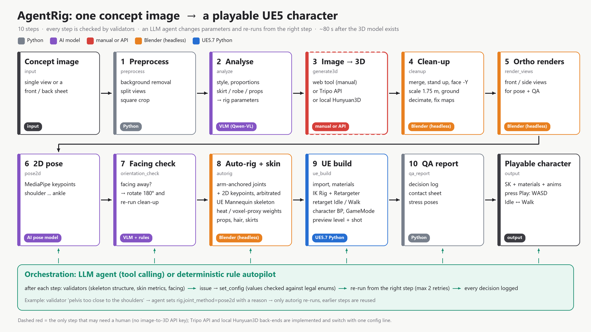
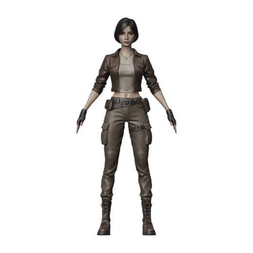
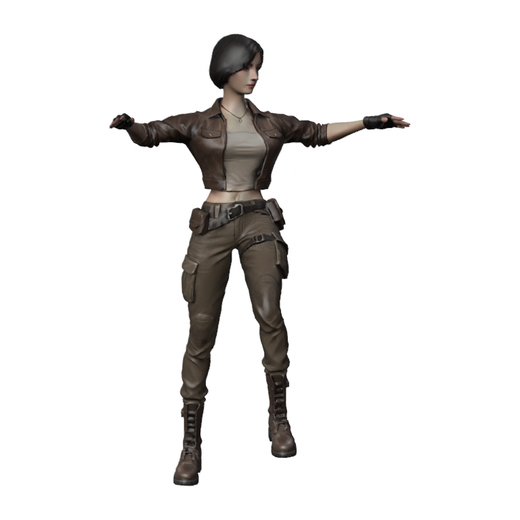
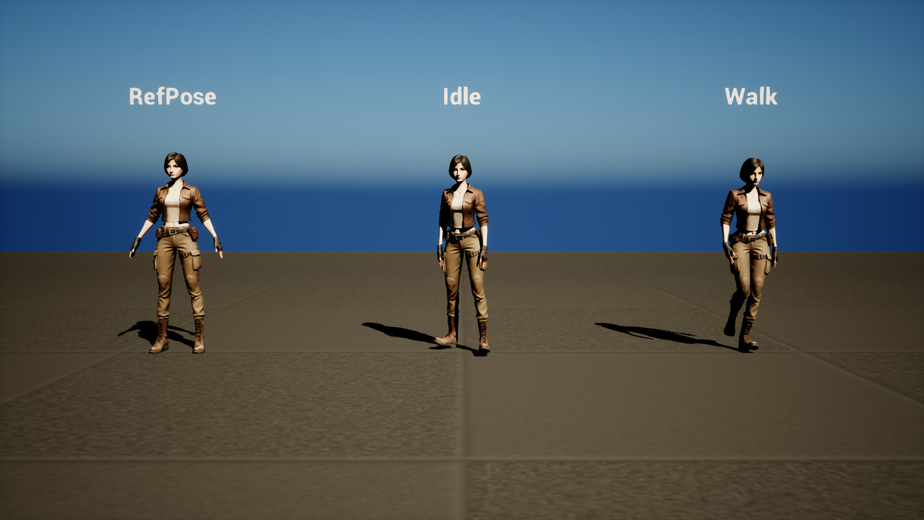
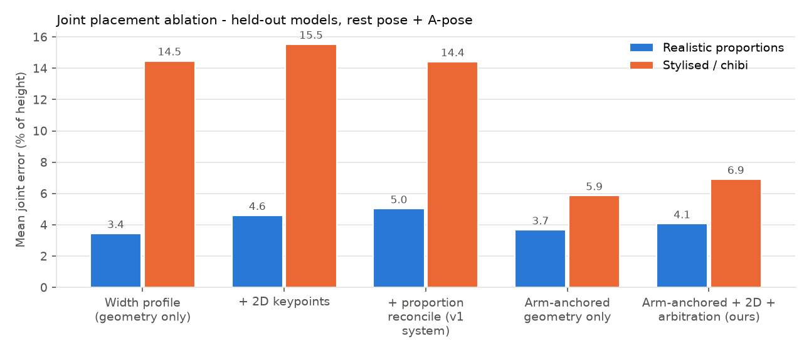
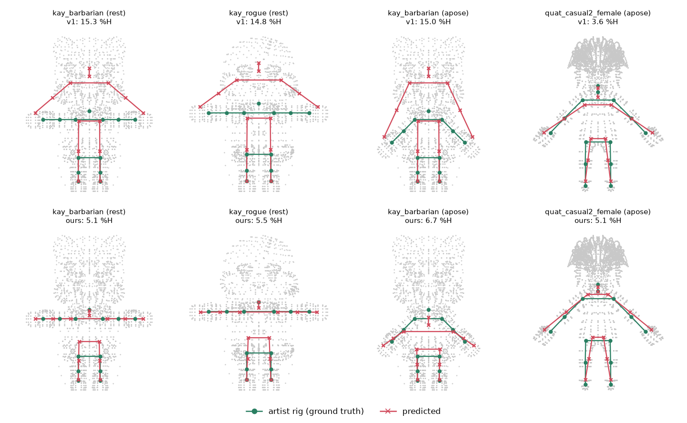

# AgentRig

**From one character concept image to a rigged, skinned, playable Unreal Engine 5 character, orchestrated by an LLM agent that checks every step and repairs its own failures.**




AgentRig is a production-style pipeline plus a small research study on one question:
*how far can automatic rigging of AI-generated characters go when the proportions are not
realistic?* Image-to-3D models now give you a textured mesh in a minute, but the mesh has no
skeleton, no skin weights, arbitrary orientation and scale, and often stylised (chibi,
big-headed) proportions that break the assumptions classical auto-riggers make.

| Input concept | Auto-rig + stress test | In UE5.7 (reference / Idle / Walk) |
|---|---|---|
|  |  |  |

## What it does

1. **Preprocess** - background removal (rembg), splits a front/back concept sheet into views.
2. **Analyse** - a vision-language model (Qwen-VL) reads the concept: front view, style,
   proportions, skirts/robes, props, rigging risks.
3. **Image → 3D** - Tripo API, a local Hunyuan3D-2.1 server, or a model made in any web tool.
4. **Clean-up** (Blender, headless) - merge, stand up, face −Y, scale to 1.75 m, ground on
   the feet, decimate, fix "unlit" web-exported materials.
5. **Orthographic renders** → **2D pose** (MediaPipe) → **facing check** (VLM + rules).
6. **Auto-rig** - joint placement from geometry + 2D keypoints with explicit arbitration
   (see below), a UE5-Mannequin-compatible skeleton, self-healing skin weights (bone heat
   → voxel-proxy fallback → rigid props, head-attached hair/earrings, cloth smoothing).
7. **UE build** (UE5.7 Python, windowless editor) - import, material instances, IK Rig,
   IK Retargeter, retargeted Idle/Walk, anim blueprint, character blueprint, GameMode,
   a preview level and a screenshot. Press **Play** and walk the character with WASD.
   A headless **Play-in-Editor test** then drives the pawn forward and checks that the feet
   actually step (it caught a foot-IK bug that never showed in the preview level).
8. **QA report** - contact sheet, stress poses and the full decision log.

**Orchestration.** Every step emits a machine-readable report; *validators* turn reports into
issues with executable fixes (`set rig.weight_method=proxy_heat, re-run from autorig`).
A deterministic **rule autopilot** and an **LLM agent** (OpenAI-compatible tool calling,
DeepSeek by default) consume the same issues. The agent can also look at QA renders through
the VLM. Every decision - who, what and why - is logged.

## Research question: joint placement on stylised bodies

Classical geometric auto-rigging reads the *width profile* of the body: the widest slice under
the head is the shoulder line, the narrowest slice above it the neck. For a chibi character the
head is wider than the torso and that assumption collapses - the skeleton ends up inside the
head while every skin-weight metric stays green. Adding a 2D pose estimator does not simply
fix it: **MediaPipe fails on the same characters**, placing the shoulders at the jaw of large
heads. Trusting 2D over geometry fixes some characters and breaks others.

**Arm-anchored joint placement.** Starting from each hand, the mesh is swept towards the body
with vertical ray casts; the arm's cross-section stays short until it merges into the torso,
where it jumps. That junction gives the shoulder line without any assumption about head size.
It then acts as an **arbiter**: 2D shoulders that disagree with it by more than 6 % of the
height are rejected; if no arm anchor exists (arms hanging straight down), a large disagreement
is read as stylised proportions and the vertical structure is rebuilt from the keypoints.

### Benchmark

Ground truth for "where should the joints be" comes from artists: 21 permissively licensed,
artist-rigged humanoids (14 Quaternius, 5 KayKit chibi, CesiumMan, a cartoon robot) are baked
into **unrigged** meshes (rest pose and a 45° A-pose), pushed through the pipeline, and the
result is compared with the original rig:

* **MPJPE** - mean error of 14 joints (neck, head, shoulders, elbows, wrists, hips, knees,
  ankles), in % of character height;
* **part accuracy** - share of vertices whose dominant bone belongs to the same body part
  (14 parts) as in the artist's skin weights.

Six models were used while developing the method; the remaining fifteen are **held out**.



Held-out models (15 models × 2 poses = 30 runs), mean joint error in % of height:

| Joint placement | Realistic | Stylised | All | Runs < 8 % H |
|---|---|---|---|---|
| Width profile (classical geometry) | **3.4** | 14.5 | 5.6 | 77 % |
| + 2D keypoints + proportion reconcile (my first version) | 5.0 | 14.4 | 6.9 | 63 % |
| Arm-anchored geometry | 3.7 | **5.9** | **4.1** | **100 %** |
| Arm-anchored + 2D keypoints + arbitration (current default) | 4.1 | 6.9 | 4.6 | 93 % |

**What the numbers say**

1. **The arm anchor fixes stylised bodies**: joint error on chibi characters drops from 14.5 % to
   5.9 % of height (2.5×), at a cost of 0.3 points on realistic ones.
2. **2D keypoints did not help on this benchmark.** MediaPipe found a person in only 12 of 41
   renders; where it did, arbitration rejected its arms 9 times, and the remaining leg keypoints
   still made the result worse in 9 of the 12 cases. Geometry-only arm anchoring is the best
   variant. I have not switched the default yet: that decision would be made on the test set,
   and needs confirming on fresh data (real image-to-3D outputs, see the technical report).
3. **Skinning post-processing is a trade-off**, not a free win: +1.8 points of part accuracy on
   realistic bodies, −3.4 on chibi ones. The ablation also exposed a real bug (the fallback kept
   its *last* rather than its *best* attempt), now fixed.
4. **The structural validators are a weak detector**: they flag 1 of the 5 remaining failures,
   with 6 false alarms. Catching wrong rigs needs more than proportion rules.



Full tables, per-model numbers and the validator self-check: [`docs/results/RESULTS.md`](docs/results/RESULTS.md).
Method details, failure analysis and limitations: [`docs/TECH_REPORT.md`](docs/TECH_REPORT.md).
Reproduce:

```bash
python tools/benchmark/download.py --data ../bench_data      # ~35 MB, CC0 / CC-BY models
python tools/benchmark/run_benchmark.py --data ../bench_data # ~30 min on a laptop CPU
python tools/benchmark/report.py --data ../bench_data
```

## Quick start

Requirements: Python 3.10-3.11, Blender 4.2+ (5.x tested), Unreal Engine 5.7 with the
*Third Person* template content and the Python Editor Script / Editor Scripting Utilities /
IK Rig plugins enabled.

```bash
python -m venv .venv && .venv\Scripts\pip install -r requirements.txt
copy config.example.yaml config.yaml      # set Blender / UE / project paths

# API keys only ever live in environment variables
setx LLM_API_KEY "..."     # agent (DeepSeek or any OpenAI-compatible endpoint)
setx VLM_API_KEY "..."     # vision model (Qwen-VL), optional
setx TRIPO_API_KEY "..."   # only for gen3d.backend=tripo

# a model from any image-to-3D web tool + its concept image, LLM agent orchestration
python run_pipeline.py --image concept.png --name Hero --mode agent --set gen3d.manual_model=hero.glb

# deterministic rule autopilot; resume from a step with a changed parameter
python run_pipeline.py --image concept.png --name Hero
python run_pipeline.py --name Hero --set rig.weight_method=proxy_heat --from autorig

# artist UI
python ui/app.py
```

Close the UE editor before running: the pipeline starts a windowless editor on the same project.
Results: `output/<name>/07_qa/REPORT.md` and, in UE, `Content/AIChar/<name>/` with a preview
level `Maps/L_<name>_Preview` - press Play.

## Repository layout

```
run_pipeline.py            CLI entry point            ui/app.py        Gradio UI
pipeline/                  steps, validators, agent, LLM client, run state
blender_scripts/           clean-up, renders, joint estimation, skeleton, skinning, FBX
ue_scripts/                UE5.7 import / materials / IK Rig / retarget / level
tools/benchmark/           dataset download, baking, evaluation, report, figures
tests/                     unit tests (no Blender / UE needed), run in CI
docs/                      ARCHITECTURE, TECH_REPORT, ENGINEERING_LOG, results/
```

## What is automatic and what is not

| Step | Automatic | Human |
|---|---|---|
| Preprocess, analysis, clean-up, joints, skeleton, skinning, UE build, QA | yes | - |
| Image → 3D | yes with a Tripo key or a local Hunyuan3D server | otherwise: upload the views to a web tool and pass the `.glb` back |
| Retries / parameter changes | agent or autopilot, logged | - |
| Final visual review | VLM pre-check | a human should look at the contact sheet |

## Limitations

* Fingers have bones but are not skinned (AI meshes usually fuse them).
* Hair, capes and earrings follow the main skeleton; no secondary-motion chains or physics.
* The arm anchor needs arms that leave the body (T/A-pose); arms hanging straight down fall
  back to width profile + 2D keypoints.
* Skin weights come from geometric heat diffusion; a learned rigging model (e.g. UniRig) would be
  a natural alternative back-end - the Mannequin-compatible skeleton keeps the UE side unchanged.
* Benchmark ground truth is "where the artist put the joints"; rig conventions differ between
  asset packs, so a few percent of error is convention, not failure.

## Credits and disclosure

* Benchmark models (not redistributed, downloaded by script): Quaternius *Ultimate Animated
  Character Pack* (CC0), Kay Lousberg *KayKit Adventurers* (CC0), Cesium *CesiumMan* (CC-BY 4.0,
  Khronos glTF Sample Assets), Tomás Laulhé *RobotExpressive* (CC0, three.js examples).
* Open-source components: Blender, rembg, MediaPipe, Gradio; Unreal Engine 5.7 and its
  Third Person template content (not included).
* **AI assistance:** large parts of the code and documentation were written with the help of
  Claude (Anthropic) in pair-programming fashion; design decisions, experiments and their
  interpretation were reviewed by the author.

MIT License.
