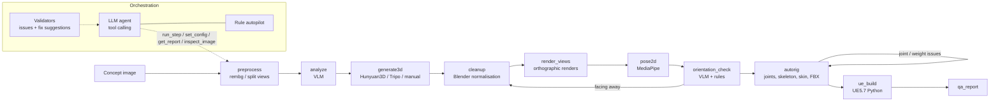

# Architecture



## Key design decisions

1. **One skeleton standard.** Every character gets the UE5 Mannequin (Manny) bone names and
   hierarchy, including the non-deforming `ik_foot_l/r` helpers the template's foot-IK Control Rig
   reads. UE's `apply_auto_generated_retarget_definition()` recognises the template, so retarget
   chains, the Manny animation library and the template anim blueprint work without configuration.
2. **Joint placement = geometry + 2D keypoints, with arbitration.**
   - *Arm-anchored geometry*: from each hand, vertical ray casts sweep towards the body; the
     shoulder is where the arm's cross-section jumps into the torso. Neck = narrowest central slice
     above it; crotch = first solid point of a front-to-back ray between the legs.
   - *2D keypoints*: MediaPipe on an orthographic front render, back-projected exactly (orthographic
     camera); depth from the midpoint of a ray through the mesh.
   - *Arbitration*: 2D shoulders that disagree with the arm-anchored line by > 6 % H are rejected
     (MediaPipe fails on big heads). Without an arm anchor (arms hanging down), a large
     disagreement is read as stylised proportions and the vertical structure is rebuilt from 2D.
   - Symmetrisation and monotonic-chain sanity checks at the end.
3. **Self-healing skinning.** Bone heat → unweighted-vertex / empty-bone check → voxel-proxy heat
   → loose islands copy body weights → head-attached parts follow the head → far-weight pruning
   → cloth smoothing between the legs → 4 influences, normalised.
4. **Explainable orchestration.** Every step returns a machine-readable report; validators turn it
   into issues carrying executable fix suggestions. The rule autopilot and the LLM agent consume the
   same issues; every decision (who, what, why) goes to `state.json` and the QA report.
5. **Resumable runs.** `state.json` stores step status, reports and config overrides; any step can
   be re-run alone (`--from`, `--only`).

## Files per run

```
output/<name>/
  01_preprocess/view_*.png          cut-out views
  02_gen3d/raw_model.glb            image-to-3D result
  03_cleanup/clean.blend, textures/ normalised mesh + textures (+ the normalisation transform)
  04_views/front.png, keypoints.json
  05_rig/SK_<name>.fbx, <name>_rigged.blend, qa/*.png
  06_ue/manifest.json, ue_report.json, ue_preview.png, play_test.json
  07_qa/REPORT.md, contact_sheet.png
  state.json                         step states and the decision log
  logs/*.log
```
