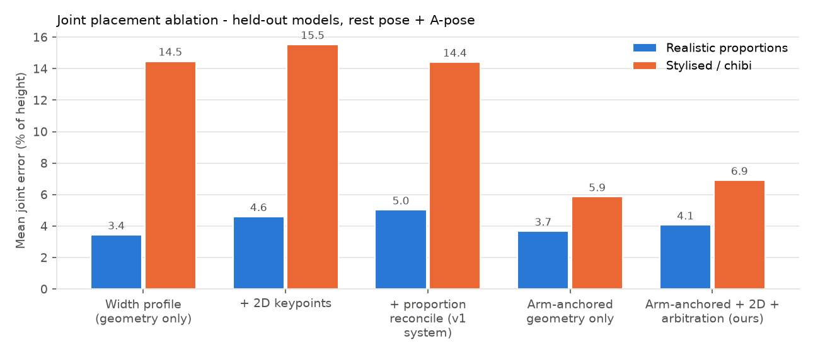
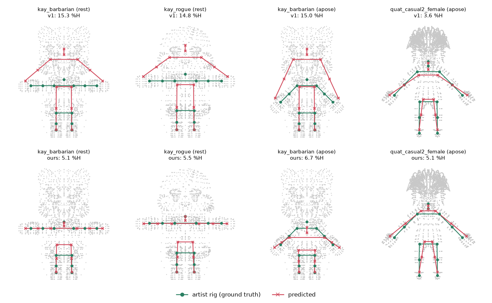

# Arm-anchored joint placement for automatic rigging of stylised AI-generated characters

*Technical report for AgentRig.*

## 1. Problem

Image-to-3D models produce textured but unrigged meshes. Turning them into game characters
needs a skeleton whose joints sit at anatomically plausible places, skin weights, and an engine
import that can play existing animation. Classical geometric auto-rigging works on realistic
bodies but relies on proportion priors - "the widest slice under the head is the shoulder line",
"the head is narrower than the shoulders" - that stylised characters (chibi, big heads, large
hats and pauldrons) violate. A natural fix is to add a learned 2D pose estimator on a rendered
view. This report shows that, on stylised bodies, **the pose estimator fails on the same
characters**, so neither cue can be trusted unconditionally, and proposes a geometric cue that
does not depend on proportions and can arbitrate between the two.

## 2. Pipeline context

The joint estimator sits inside a ten-step pipeline (concept image → background removal → VLM
analysis → image-to-3D → clean-up → orthographic renders → 2D pose → facing check → auto-rig
→ UE5 build → QA). The mesh entering the rig step is normalised: upright, facing −Y,
1.75 m tall, feet centred at the origin. Each step is followed by validators that turn its
report into issues with executable fixes; a rule autopilot or an LLM agent applies them.
See [ARCHITECTURE.md](ARCHITECTURE.md).

## 3. Method

**Width profile (baseline geometry).** For horizontal slices, the half-width of the central body
part is measured by rays shot from inside the body along ±X; consecutive hits closer than 2 % H
are treated as layers of the same part (clothes over skin), a larger gap ends the part (an arm
hanging beside the torso). Head = widest slice in the top 22 %, shoulders = widest slice below
it, neck = narrowest between them. Crotch = first solid point of a front-to-back ray at x = 0;
hips, knees and ankles follow from crotch and feet.

**2D keypoints.** MediaPipe Pose on an orthographic front render. Because the camera is
orthographic, keypoints back-project exactly to world X/Z; depth is the midpoint of a front-back
ray through the mesh. Hip keypoints only contribute X (MediaPipe hips sit on the iliac crest).

**Proportion reconcile (v1).** If confident 2D shoulders disagree with the geometric shoulder
line by more than 8 % H, the body is assumed stylised and neck, clavicles and pelvis are rebuilt
from the keypoints. It looks right on a single chibi example - and, as the benchmark shows,
breaks big-headed realistic characters.

**Hands.** Not the most lateral vertex: wide hats, pauldrons and capes stick out further than
the hands. We take the lateral-extent profile over height, keep its strong local maxima
(≥ 60 % of the global maximum) and choose the lowest one.

**Arm anchor (ours).** From each hand, step towards the body in x. At every step cast vertical
rays (three depths around the arm's depth midpoint) and keep the inside-mesh interval that
continues the tracked arm. On the arm the interval height is the arm thickness; where the arm
merges into the torso it jumps to the torso height. The first slice whose interval exceeds
max(0.14 H, 2 × the running median) marks the junction; the shoulder joint is placed
0.35 × arm thickness further along the arm direction. Ray casting rather than vertex slicing
keeps this working on low-poly meshes, where a thin slice may contain no vertex at all.

**Arbitration.** If both arm anchors exist and agree, they define the shoulder line, the neck is
the narrowest central slice above it, and 2D shoulders more than 6 % H away are rejected
together with the 2D elbows and wrists (a keypoint model that misplaces the shoulders is not
trusted for the rest of the arm). Without an anchor (arms hanging down) the v1 reconcile rule
applies.

**Skeleton and skinning.** UE5 Mannequin names and hierarchy, including the `ik_foot_l/r` helper
bones that the template's foot-IK Control Rig reads at runtime, placed in the Mannequin's
hierarchy (`root → ik_foot_root → ik_foot_l/r`) and baked to follow the feet in every
retargeted animation; a headless Play-in-Editor test checks that the feet actually step. Weights: Blender bone heat, a
voxel-remeshed proxy when heat leaves vertices unweighted, then post-processing (loose islands
copy the nearest body weights; parts hanging from the head follow it; influences from bones
far away are pruned; cloth between the legs is smoothed; 4 influences, normalised).

## 4. Benchmark

**Data.** 21 artist-rigged humanoids with permissive licences: 14 Quaternius characters
(stylised-realistic, large heads), 5 KayKit adventurers (chibi, separate meshes, helmets/hats,
hand props removed), CesiumMan (realistic low-poly, arms down) and RobotExpressive (cartoon
robot). Each is evaluated in its rest pose (T-pose for all but CesiumMan) and with the upper arms
lowered by 45° (A-pose). Six models were inspected while developing the arm anchor
(Casual_Male, Suit_Female, Knight, Mage, CesiumMan, RobotExpressive); fifteen are held out.

**Protocol.** The artist rig is baked into a single unrigged mesh (posed, no vertex groups) - the
same kind of input an image-to-3D model gives. The pipeline runs clean-up, renders and 2D pose
once per mesh, then the rig step once per variant. Ground-truth joints and points are mapped into
the pipeline's normalised space with the similarity transform recorded by clean-up.

**Metrics.** MPJPE over 14 joints (neck, head, shoulders, elbows, wrists, hips, knees, ankles)
in % of height; PCK@5 %H; *part accuracy* - for every output vertex, the body part (14 parts) of
its dominant bone versus the part of the nearest ground-truth vertex's dominant bone - and
part mIoU. Ground truth reflects each pack's rigging conventions (e.g. where exactly the neck or
the hip joint sits), so a residual of a few percent is expected even for a "correct" rig.

## 5. Results

All numbers: [results/RESULTS.md](results/RESULTS.md) (generated by `tools/benchmark/report.py`).

### 5.1 Joint placement

| Variant (held-out, 30 runs) | Realistic MPJPE | Stylised MPJPE | All | PCK@5 %H | Runs < 8 %H |
|---|---|---|---|---|---|
| Width profile | 3.4 | 14.5 | 5.6 | 76 | 77 % |
| + 2D keypoints | 4.6 | 15.5 | 6.8 | 68 | 70 % |
| + proportion reconcile (v1) | 5.0 | 14.4 | 6.9 | 66 | 63 % |
| Arm-anchored geometry | 3.7 | 5.9 | 4.1 | 81 | 100 % |
| Arm-anchored + 2D + arbitration | 4.1 | 6.9 | 4.6 | 76 | 93 % |

*Width-profile geometry* is accurate on realistic proportions and fails on every chibi model
(neck and shoulders inside the head, Fig. below, top row). *Adding 2D keypoints makes every
configuration worse.* MediaPipe found a person in only 12 of 41 orthographic renders of these
untextured-looking, stylised meshes. Where it did, arbitration rejected its arm keypoints in 9
cases, but the remaining leg keypoints (knees, ankles, hip width) still increased the error in 9
of 12 cases (mean +1.3 %H). The v1 reconcile rule - trust 2D when it disagrees with geometry - is
the worst configuration on realistic bodies (5.0 vs 3.4 %H). It is exactly the failure that a
single-character test had hidden.

*The arm anchor* removes the chibi failure mode: 14.5 → 5.9 %H on held-out stylised models, all
30 held-out runs below 8 %H, for +0.3 %H on realistic models. On the development models the
gain is the same in kind (14.8 → 7.3), so the effect is not an artefact of tuning.

*Top: v1 system, bottom: ours. The three largest improvements on held-out models and the largest
regression (right).*

**Remaining errors.** (i) On chibi bodies the hips are placed 3-5 %H too high: the crotch is
found where the legs separate, but chibi rigs put the hip joints well inside the pelvis volume.
(ii) The cartoon robot (8.8-10.3 %H) has a torso narrower than its forearms and detached limb
meshes; neither geometric cue holds. (iii) Joint conventions differ between packs (e.g. KayKit
has no neck bone, so the neck joint is not evaluated there).

**Decision deferred.** The data favour arm-anchored geometry *without* 2D keypoints. Making that
the default now would be a decision taken on the test set; it should be confirmed on new data,
ideally real image-to-3D outputs, which differ from baked artist meshes (fused fingers, thick
cloth, texture-only details that help a 2D model).

### 5.2 Skinning

| Variant (held-out) | Realistic part acc | Stylised part acc | All | mIoU |
|---|---|---|---|---|
| heat + fallback + post-processing | 88.4 | 54.7 | 81.7 | 52.0 |
| voxel-proxy heat | 87.2 | 54.4 | 80.7 | 48.2 |
| no post-processing | 86.6 | 58.1 | 80.9 | 51.4 |

Post-processing helps realistic bodies (+1.8) and hurts chibi ones (−3.4); the voxel proxy is
never better than heat with fallback. Chibi part accuracy is low for every variant (≈55 %): with
a head that holds most of the vertices, small errors at the neck boundary and in the short limbs
dominate. The ablation also found a bug: the heat → proxy fallback returned the *last* attempt,
and on 6 of 41 meshes the proxy failed completely (all weights zero), which post-processing had
silently patched. The numbers above are after the fix.

### 5.3 Can the validators tell a wrong rig?

With MPJPE > 8 %H as "failure", the structural validators flag 1 of 5 failures and raise 6
false alarms. Proportion rules catch gross errors (pelvis in the chest) but not the subtler ones
left after the arm anchor. This motivates a learned or vision-based rig checker - for example,
asking the VLM to compare stress-pose renders, or checking deformation energy under a test
animation - as future work for the agent loop.

### 5.4 End-to-end example

On a realistic A-pose character from a web image-to-3D tool, 200 k vertices (decimated to 50 k
triangles), the full agent run took 124 s: Blender steps ~15 s, UE build 61 s, the rest agent
and VLM calls. The agent inspected the renders and the UE screenshot through Qwen-VL and needed
no retries.

## 6. Limitations and next steps

* The arm anchor assumes arms that leave the body. An I-pose would need a different cue (e.g.
  the armpit gap seen from the side, or a pose estimator trained on stylised characters).
* Part accuracy measures segmentation-level correctness, not deformation quality; a
  deformation-based metric (posing both rigs with the same animation and comparing vertex
  positions) would be stronger but requires a joint correspondence for every bone.
* 21 models / 2 poses is small; the next step is a larger set (e.g. Mixamo-style characters
  with licences that allow evaluation) and a learned baseline (UniRig, RigNet) on the same
  protocol.
* Fingers, secondary motion (hair, capes) and facial rigs are out of scope.
